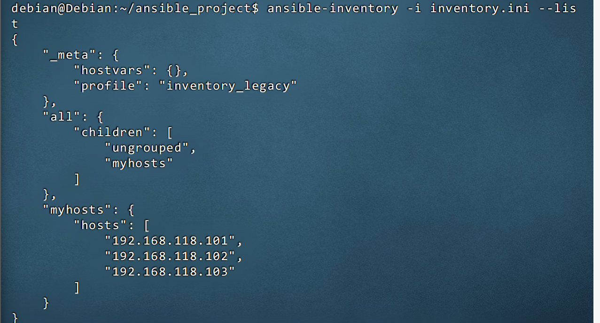
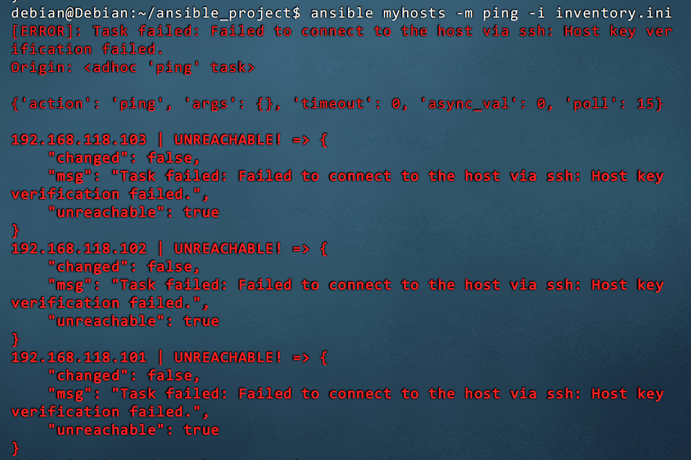
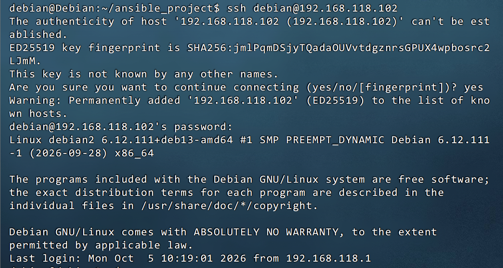
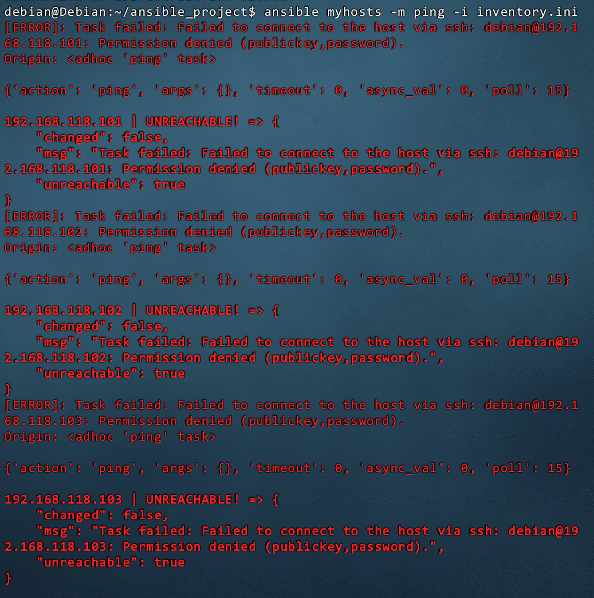
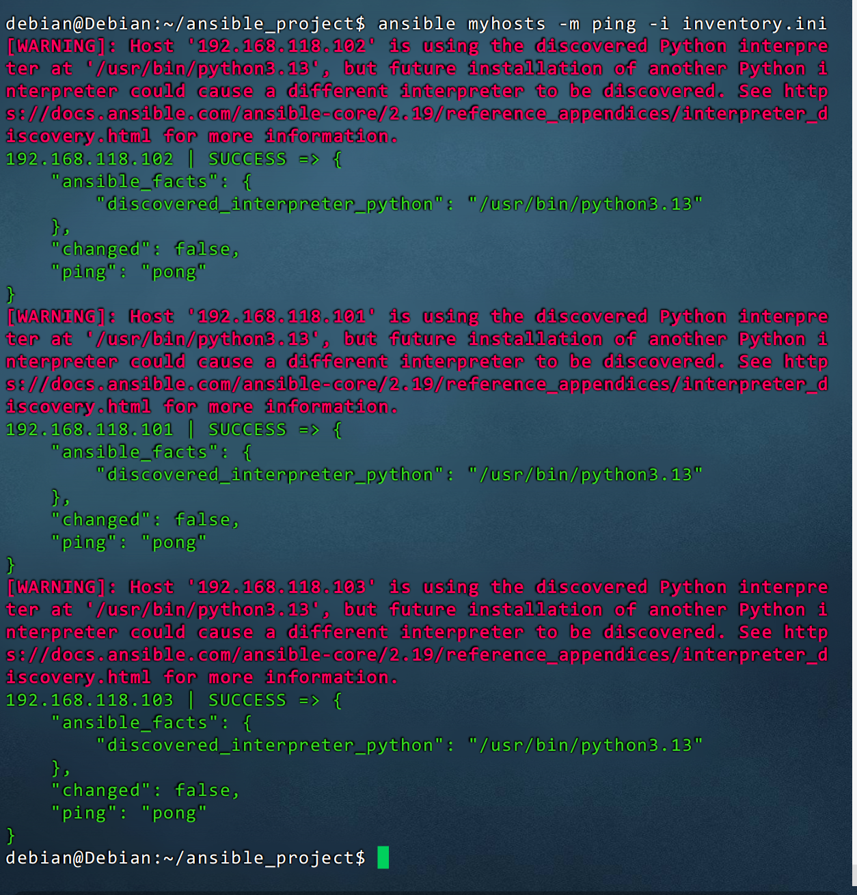
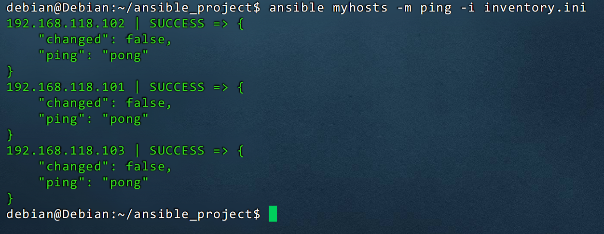
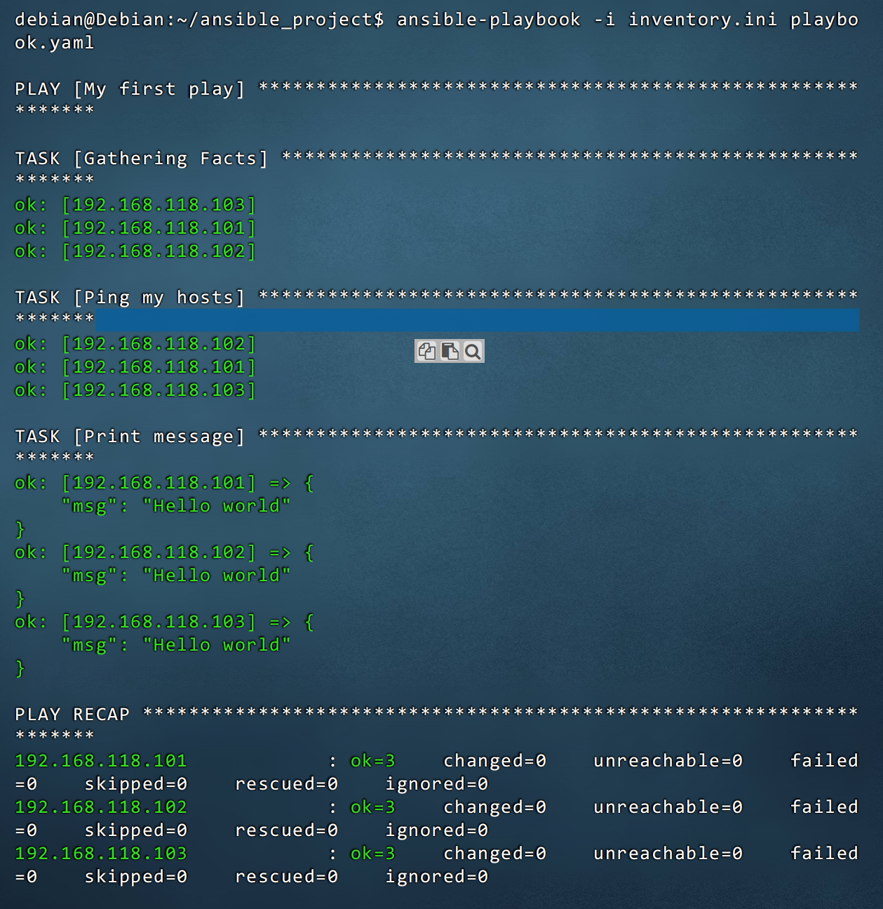

> 环境说明：主控端系统为 Debian 13.7，受控端为三台虚拟机（192.168.118.101 ~ 103）。本文记录了从安装到成功运行首个剧本的完整过程，希望能帮你绕过新手常见的坑。

## 一、Ansible 的安装下载

在正式动手之前，先把 Ansible 装到主控端。执行安装命令：
```bash
sudo apt install ansible
```

验证安装是否成功，查看版本信息：
```bash
ansible --version
```

## 二、构建清单（Inventory）

装好 Ansible 之后，还不能直接管理机器——Ansible 需要先知道“要去管谁”。这份受控机器的名单，就是清单（Inventory）。

### 1. 创建项目文件夹
养成好习惯，为 Ansible 项目建立独立的文件系统目录：
```bash
mkdir ansible_project && cd ansible_project
```

### 2. 创建清单文件
```bash
touch inventory.ini
```
写入受控虚拟机的 IP（简单分组）：
```text
[myhosts]
192.168.118.101
192.168.118.102
192.168.118.103
```

### 3. 验证清单
使用 Ansible 自带工具验证清单解析是否正常：
```bash
ansible-inventory -i inventory.ini --list
```


### 4. 对清单中的 `myhosts` 组执行 Ping 操作
清单没问题后，先用最轻量的 ping 模块探一探连通性：
```bash
ansible myhosts -m ping -i inventory.ini
```


这里的报错是正常的。第一次通过 SSH 连接一台新机器时，SSH 客户端（也就是你的 Ansible 主控机）会要求确认目标主机的指纹。因为你的 `~/.ssh/known_hosts` 文件里没有这三台机器的记录，而 Ansible 默认的安全策略是拒绝连接未知主机，因此报了 `Host key verification failed`。

> **修复方案：**
> 手动 SSH 连接一次，执行命令：
> ```bash
> ssh root@192.168.118.101  # 假设受控系统用户是 root
> ssh root@192.168.118.102
> ssh root@192.168.118.103
> ```

这里需要交互一下，选 `yes` 确认连接，需要对受控系统执行登录操作。


重新 ping 还是报错：


这说明光确认指纹还不够，还需要免密登录。执行命令：
```bash
# 如果你之前没生成过密钥，先执行这句，一路回车
ssh-keygen -t rsa

# 把公钥拷贝给受控机（每台机器都执行一次）
ssh-copy-id debian@192.168.118.101
ssh-copy-id debian@192.168.118.102
ssh-copy-id debian@192.168.118.103
```

再次 ping 就成功了！


这里的报错是 Ansible 自动扫描到了受控机的 Python 解释器（`/usr/bin/python3.13`），但它警告你：如果没有在配置里“写死”，以后受控机如果安装了其他版本的 Python，Ansible 可能会找错版本导致报错。

> **消除方案：**
> 重新打开清单文件，新增如下内容：
> ```ini
> [myhosts]
> 192.168.118.101
> 192.168.118.102
> 192.168.118.103
> 
> [myhosts:vars]
> ansible_user=debian
> ansible_python_interpreter=/usr/bin/python3.13
> ```

再次 ping，红字警告消失，到这就完全胜利了！


## 三、创建并运行第一个剧本（Playbook）

连通性没问题了，但 `ping` 只是单条命令，谈不上真正的“自动化运维”。要把一系列操作固化下来、批量执行，就得靠剧本（Playbook）——它才是 Ansible 的核心。

### 1. 创建剧本文件
在 Ansible 项目文件夹新建剧本文件 `playbook.yaml`，写入剧本信息：
```yaml
- name: My first play
  hosts: myhosts
  tasks:
   - name: Ping my hosts
     ansible.builtin.ping:

   - name: Print message
     ansible.builtin.debug:
       msg: Hello world
```

### 2. 运行剧本
```bash
ansible-playbook -i inventory.ini playbook.yaml
```

运行结果：


## 四、Playbook 编写技巧：剧本翻译笔记

第一个剧本跑通了，接下来自然要面对一个问题：日常运维里那一堆 shell 命令，该怎么变成 Playbook？其实写剧本的核心思路只有一句话，理解它之后，写剧本就不再是“背语法”，而是“做翻译”。

### 核心一句话

**写剧本 = 把命令翻译成模块。**

> 有了这个认知，下面的“翻译七步”就是一个可复用的套路：从一条命令出发，一步步落到一份能跑的 YAML。

### 翻译七步

#### 1. 手动做一遍，记下命令

先别急着写 YAML，把你要做的事在机器上手动跑一遍，拿到确切的命令：
```bash
hostnamectl set-hostname node1
```

#### 2. 查对应模块

拿到命令后，去 Ansible 的模块库里找“翻译对照”：
```bash
ansible-doc -l | grep -i hostname
```

得到模块名：`hostname`

#### 3. 看模块参数

模块找到了，还要确认它有哪些参数、参数叫什么名字：
```bash
ansible-doc hostname
```

找到参数：`name`

#### 4. 写 task

命令、模块、参数都齐了，就可以把命令“翻译”成一个任务（task）：
```yaml
- name: 修改主机名
  ansible.builtin.hostname:
    name: node1
```

#### 5. 固定值换变量

能写死，更要能复用。把写死的值替换成变量，让同一个 task 适配不同的机器：
```yaml
- name: 修改主机名
  ansible.builtin.hostname:
    name: "{{ inventory_hostname }}"
```

`inventory_hostname` 的值 = inventory 里写的主机名。

#### 6. 塞进 play 结构

单个 task 只是零件，要装进完整的 play 结构里才能被 Ansible 执行：
```yaml
---
- name: 基础配置
  hosts: all
  become: true
  tasks:
    - name: 修改主机名
      ansible.builtin.hostname:
        name: "{{ inventory_hostname }}"
...
```

#### 7. 验证

写完别急着直接跑，先用三步验证层层把关，避免“一跑就炸”：
```bash
ansible-playbook -i inventory.ini xxx.yaml --syntax-check
ansible-playbook -i inventory.ini xxx.yaml --check --diff
ansible-playbook -i inventory.ini xxx.yaml
```

### 命令 ↔ 模块对照

翻译的关键在于“查到对的模块”。下面这张表把常见命令和对应的模块整理在一起，写剧本时可以直接查：

| 命令 | 模块 |
|------|------|
| `hostnamectl set-hostname` | `hostname` |
| `useradd` | `user` |
| `apt install` | `apt` |
| `systemctl restart` | `service` / `systemd` |
| `sed -i` | `lineinfile` |
| `cp` | `copy` / `template` |

### 缩进规则

YAML 靠缩进表达层级，写错缩进是最常见的翻车点。记住这条规则即可：

```yaml
- name: task名              # 2空格 + "- "
  模块名:                    # 和 name 对齐
    参数: 值                 # 比模块名多缩进 2 格
```

- 冒号后必须有空格
- 同级对齐
- 参数比模块名多缩进 2 格

### 翻译口诀

把上面的套路浓缩成一句话，写剧本时照着走就行：

**手动命令 → 查模块 → 看参数 → 写 YAML → 换变量 → 套结构 → 三步验证。**

## 五、实战心得与常见误区

走完“安装 → 清单 → 剧本 → 翻译套路”这一整条路，再把下面这几点记住，能少踩很多坑：

1. **关于报错**：Ansible 入门阶段遇到 `Host key verification failed`（未记录指纹）和 `Permission denied`（未配置免密）是必经之路。手动 SSH 一次并配置 `ssh-copy-id` 是最一劳永逸的做法。
2. **关于“受控端没有反应”**：这是 Ansible 的设计哲学。Ansible 是集中式输出，受控机在后台静默执行，结果会通过网络统一返回到主控端的屏幕上。你不需要去每台受控机上检查。
3. **关于 `PLAY RECAP`**：如果看到 `ok=3 changed=0 unreachable=0 failed=0`，说明三台机器均执行成功，没有任何异常，这就是最完美的状态。

---

